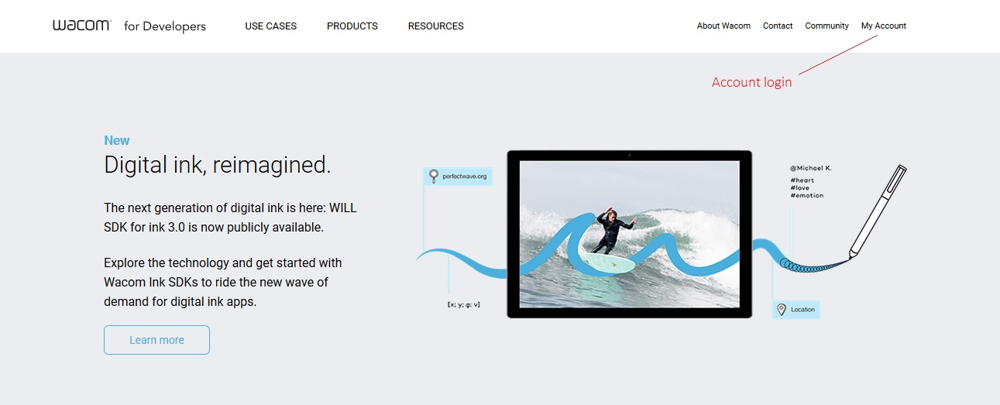
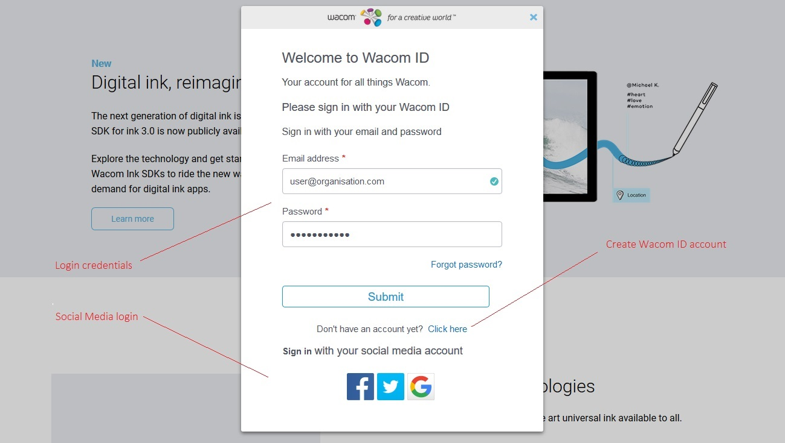
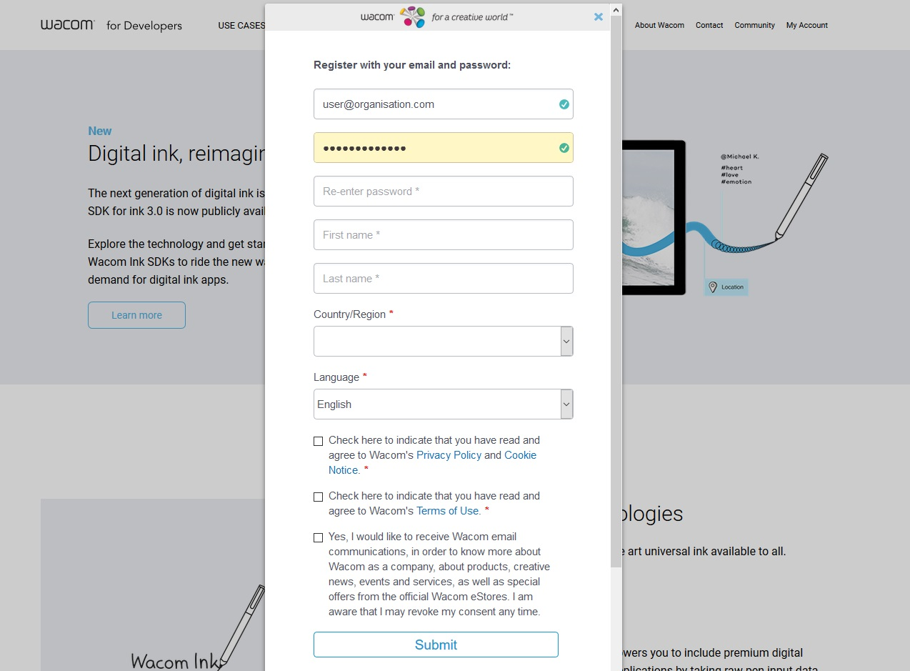
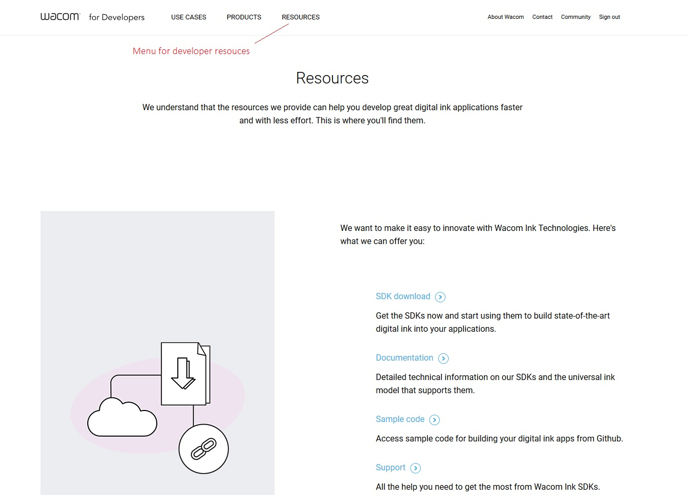
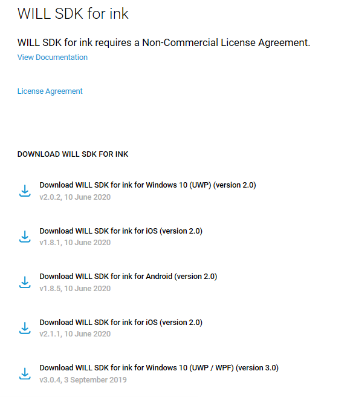
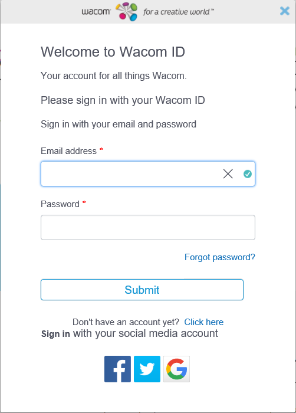
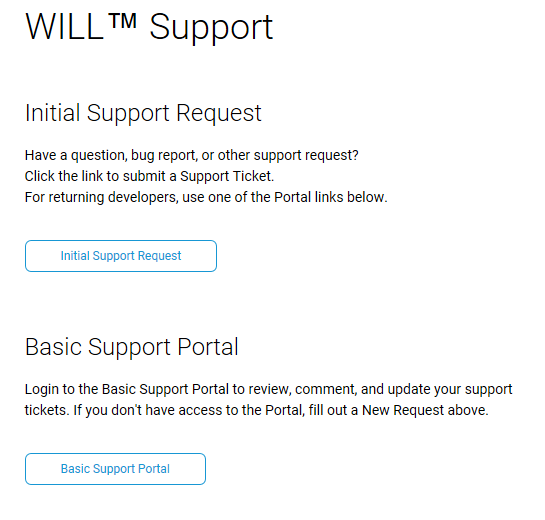
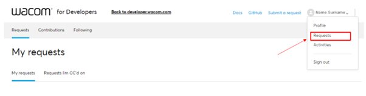

# Welcome Page

## Welcome to the Wacom for developers GitHub pages

Here you can find supplementary instructions and the latest information for the developer GitHub repositories.

The GitHub repositories have been created in support of the Wacom Developer Relations website described below.

## Contents

### Developer Relations Repositories

| Repository                                                                                                           | Description                                |
| -------------------------------------------------------------------------------------------------------------------- | ------------------------------------------ |
| [Wacom Device Kit: STU SDK](https://github.com/Wacom-Developer/stu-sdk-samples)                                      | STU SDK sample code                        |
| [Wacom Device Kit: STU SigCaptX](https://github.com/Wacom-Developer/stu-sdk-sigcaptx-samples)                        | STU SDK web sample code                    |
| [Wacom Device Kit: Windows](https://github.com/Wacom-Developer/wacom-device-kit-windows)                             | Windows sample code                        |
| [Wacom Device Kit: macOS Multi-Touch](https://github.com/Wacom-Developer/wacom-device-kit-macos-multi-touch)         | macOS Multi-Touch sample code              |
| [Wacom Device Kit: macOS ScribbleDemo](https://github.com/Wacom-Developer/wacom-device-kit-macos-scribble-demo)      | macOS Scribble Demo sample code            |
| [Wacom Device Kit: macOS Tablet Controls](https://github.com/Wacom-Developer/wacom-device-kit-macos-tablet-controls) | macOS Tablet Controls sample code          |
| [Wacom Device Kit: macOS Tablet Mapping](https://github.com/Wacom-Developer/wacom-device-kit-macos-tablet-mapping)   | macOS Tablet Mapping sample code           |
| [Wacom Device Kit: macOS Wacom Driver API](https://github.com/Wacom-Developer/wacom-device-kit-macos-api)            | macOS Wacom Driver API                     |
| [Wacom Device Kit: Linux](https://github.com/Wacom-Developer/wacom-device-kit-linux)                                 | Linux sample code                          |
| [Wacom Device Kit: Android](https://github.com/Wacom-Developer/wacom-device-kit-android)                             | Android sample code                        |
| [Wacom Device Kit: Chrome OS](https://github.com/Wacom-Developer/wacom-device-kit-chromeOS)                          | Links to Android & web sample code         |
| [Wacom Device Kit: Web](https://github.com/Wacom-Developer/wacom-device-kit-web)                                     | Web API sample code                        |
|                                                                                                                      |                                            |
| [SDK for ink: Windows UWP](https://github.com/Wacom-Developer/sdk-for-ink-uwp)                                       | WILL SDK for ink sample code - Windows UWP |
| [SDK for ink: Windows WPF](https://github.com/Wacom-Developer/sdk-for-ink-wpf)                                       | WILL SDK for ink sample code - Windows WPF |
| [SDK for ink: JavaScript](https://github.com/Wacom-Developer/will-ink-sdk-js-samples)                                | WILL SDK for ink sample code - JavaScript  |
| [WILL XR Ink for Unity](https://github.com/Wacom-Developer/will3-3d-rendering-unity)                                 | WILL Ink Unity component                   |
| [SDK for ink: Android](https://github.com/Wacom-Developer/sdk-for-ink-android)                                       | WILL SDK for ink sample code - Android     |
|                                                                                                                      |                                            |
| [SDK for signature: Windows](https://github.com/Wacom-Developer/sdk-for-signature-windows)                           | Signature SDK sample code - Windows        |
| [SDK for signature: SigCaptX Windows](https://github.com/Wacom-Developer/sdk-for-signature-sigcaptx-windows)         | Signature SDK sample code - Windows web    |
| [SDK for signature: Android](https://github.com/Wacom-Developer/sdk-for-signature-android)                           | Signature SDK sample code - Android        |
| [SDK for signature: JavaScript](https://github.com/Wacom-Developer/signature-sdk-js)                                 | Signature SDK sample code - JavaScript     |
|                                                                                                                      |                                            |
| [SDK for multi-display: Windows](https://github.com/Wacom-Developer/sdk-for-multi-display)                           | Multi-display SDK sample code - Windows    |
|                                                                                                                      |                                            |
| [SDK for verification: Windows](https://github.com/Wacom-Developer/gsv-sdk-windows)                                  | Verification SDK sample code - Windows     |

### Non-Developer Relations Repositories

| Repository                                                                                       | Description                 |
| ------------------------------------------------------------------------------------------------ | --------------------------- |
| [Universal Ink Library](https://github.com/Wacom-Developer/universal-ink-library)                | Python library to parse UIM |
| [Personal Knowledge Library](https://github.com/Wacom-Developer/personal-knowledge-library)      | Library for PKS access      |
| [Sample implementation InkML to UIM conversion](https://github.com/Wacom-Developer/inkml-to-uim) | InkML to UIM sample         |

---

### Discontinued Developer Relations Sites

| Repository                                                                                                           | Description                        |
| -------------------------------------------------------------------------------------------------------------------- | ---------------------------------- |
| [Wacom Device Kit: Bluetooth Stylus SDK for iOS](https://github.com/Wacom-Developer/bluetooth-stylus-sdk-ios)        | Bluetooth Stylus SDK for iOS       |
| [Wacom Device Kit: iOS](https://github.com/Wacom-Developer/wacom-device-kit-ios)                                     | Mobile Stylus SDK for iOS          |
|                                                                                                                      |                                    |
| [SDK for ink: iOS](https://github.com/Wacom-Developer/sdk-for-ink-ios)                                               | WILL SDK for ink sample code - iOS |
| [WILL XR Ink for Unity](https://github.com/Wacom-Developer/will3-3d-rendering-unity)                                 | WILL Ink Unity component           |

## Developer Relations Site

Developing isn’t just about great technology, it’s about turning apps into profitable business. We can help you do that.

Wacom Developer Relations gives you access to the resources, connections and industries you need to succeed in the exciting and disruptive digital ink market.

Access the Wacom Developer Relations site here: https://developer.wacom.com

### Wacom ID

To get the full benefits of using Wacom Developer Relations first login to the site:

On your first visit you will need to create a Wacom ID which will give you full access to the resources:

Simply complete the registration process:

You will then have full access to the resources made available on the site:

### SDK Download

Typically you will use the Developer Relations site to gain access to an SDK.

For example, to download the Windows WILL SDK for ink navigate to Resources as shown above, then select DOWNLOADS...FOR INK

This will display the available download options:

Use the download icon to download a zip file containing the SDK binaries and api documentation.

### Support Procedure

For technical support with any of the products follow the link to [Wacom Developer Support](https://developer-support.wacom.com/z)

The link references the Wacom Developer support website with FAQ and form to submit a support request. To access the dashboard and track your request we recommend login with your Wacom ID.

If you do not already have a Wacom ID create one using the link provided:

The email used as the Wacom ID will be used for support emails. You can then submit the support request:

Complete the form, selecting the product you work with:

After submitting the request you will receive a confirmation email and be able to monitor its status at the requests overview page.

---
